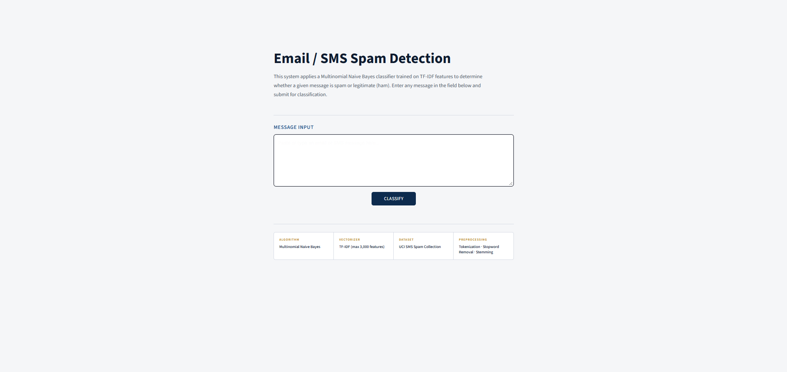
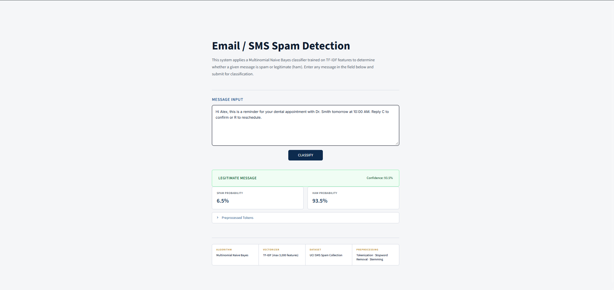
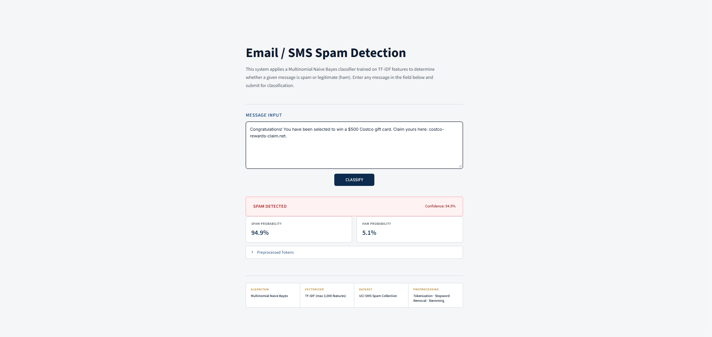

# Email or SMS Spam Detection


A machine learning web application that detects spam messages in emails and SMS using Natural Language Processing (NLP), TF-IDF vectorization, and a Multinomial Naive Bayes classifier.

## What is Spam Detection?

Spam detection is the process of identifying unwanted, irrelevant, or potentially fraudulent messages. Spam messages may contain misleading advertisements, phishing links, suspicious offers, or scams.

This project uses machine learning to analyze message text and classify it as **Spam** or **Not Spam (Ham)** through a simple web interface.

## What Are the Goals?

The main objectives of this project are:

1. Detect spam and legitimate messages automatically.
2. Apply Natural Language Processing techniques to clean and process text.
3. Convert text into numerical features using TF-IDF vectorization.
4. Use a trained Multinomial Naive Bayes classifier to predict message categories.
5. Provide an interactive web application for real-time message classification.

## Why Did I Choose This Project?

Spam messages are a common problem in digital communication. They can waste time, distribute misleading information, and expose users to phishing attempts or fraudulent offers.

This project demonstrates how machine learning and NLP can be applied to a practical text-classification problem. It also provides hands-on experience with text preprocessing, model training, prediction, and web application development.

## Features

- **Spam Classification:** Predict whether a message is Spam or Not Spam (Ham).
- **Text Preprocessing:** Clean and normalize message text before prediction.
- **TF-IDF Vectorization:** Convert text into numerical features for machine learning.
- **Machine Learning Model:** Use a trained Multinomial Naive Bayes classifier.
- **Interactive Web Interface:** Enter a message and view its predicted category.
- **Pre-trained Model:** Load the saved classifier and vectorizer without retraining every time.
- **Jupyter Notebook:** Explore the model development and analysis workflow.

## Tools and Technologies

- Python
- Streamlit
- Scikit-learn
- NLTK
- Pandas
- NumPy
- TF-IDF Vectorization
- Multinomial Naive Bayes
- Jupyter Notebook
- Git and GitHub

## How Does It Work?

1. **Input:** The user enters an email or SMS message.
2. **Preprocessing:** The text is cleaned and normalized.
3. **Feature Extraction:** The TF-IDF vectorizer converts the processed text into numerical features.
4. **Prediction:** The trained Multinomial Naive Bayes model classifies the message.
5. **Output:** The application displays the predicted category.

## Project Structure


```text
Email-or-SMS-Spam-Detection/
│
├── app.py                  # Main Streamlit application
├── model.pkl               # Trained classification model
├── vectorizer.pkl          # Saved TF-IDF vectorizer
├── requirements.txt        # Python dependencies
├── spam-detection.ipynb    # Jupyter Notebook
├── spam-detection.pdf      # Project report
├── dataset/                # Dataset files
├── style.css               # Custom styling
├── favicon.png             # Application icon
├── README.md               # Project documentation
└── .gitignore              # Git ignore rules
```

## Application Preview

### 1. Application Interface



### 2. Spam Message Prediction



### 3. Not Spam Message Prediction



## Future Improvements

- Deploy the application online for public access.
- Improve model performance through additional evaluation and experimentation.
- Add detailed prediction metrics and model evaluation visualizations.
- Enhance the user interface and support additional text formats.
- Explore more advanced NLP and machine learning techniques.

## Conclusion

This project demonstrates the practical use of machine learning and NLP for detecting unwanted messages. By combining TF-IDF feature extraction, Multinomial Naive Bayes, and Streamlit, it provides a simple and interactive spam classification application.
=======
```
---

<div align="center">

**Developed by [SARAT BANIK](https://www.linkedin.com/in/saratbanik)**

</div>
